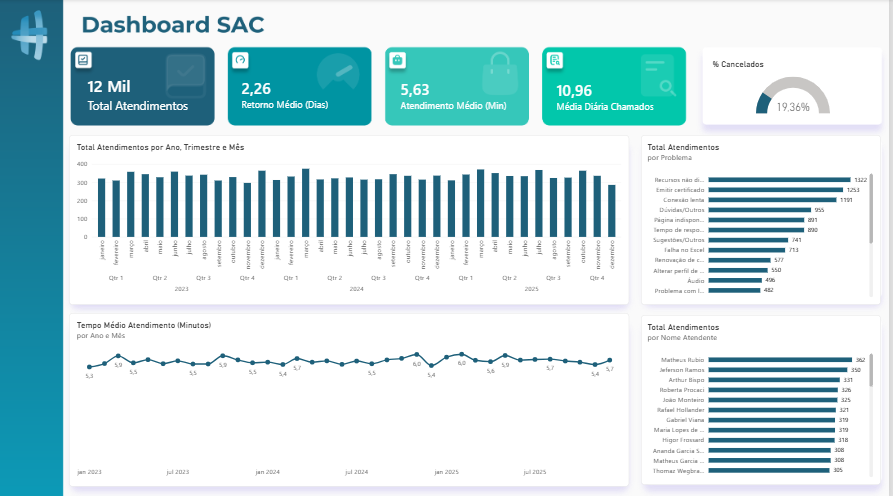
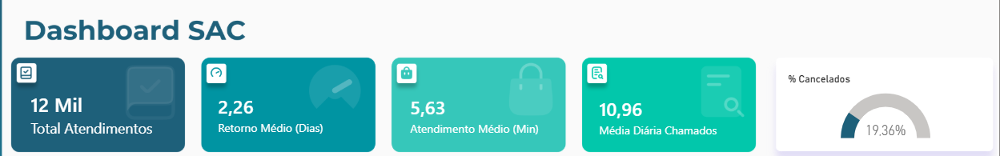
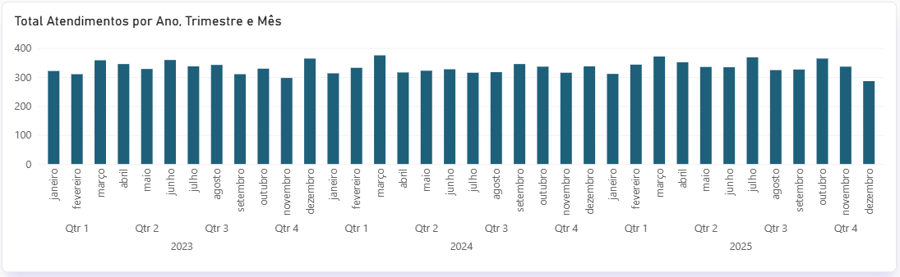
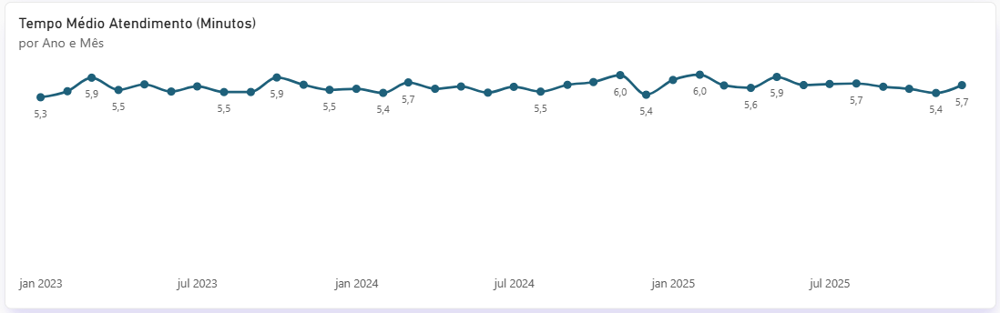
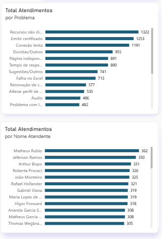

# Dashboard de Atendimento ao Consumidor (SAC) | Power BI

## Sobre o projeto

Este é meu primeiro projeto desenvolvido no **Microsoft Power BI**, com foco na análise de dados de um Serviço de Atendimento ao Consumidor (SAC).

O dashboard reúne indicadores operacionais e temporais para facilitar o acompanhamento dos atendimentos, permitindo explorar o volume de chamadas, os tempos médios, os cancelamentos e a distribuição dos atendimentos por problema relatado e por atendente.

O projeto foi desenvolvido com o objetivo de aplicar conceitos fundamentais de análise de dados, transformação de informações e visualização de indicadores, priorizando a clareza e a organização visual.

## Dashboard

### 1. Visão geral

### 2. Indicadores principais

### 3. Evolução do total de atendimentos

### 4. Evolução do tempo médio de atendimento

### 5. Rankings de principais problemas e atendentes

## Principais indicadores e análises

- **Indicadores gerais:** total de atendimentos, tempo médio de retorno (em dias), tempo médio de atendimento (em minutos), média diária de chamadas e percentual de atendimentos cancelados.
- **Análise temporal:** evolução do volume de atendimentos por ano, trimestre e mês, além da variação do tempo médio de atendimento.
- **Análise por categoria:** distribuição dos atendimentos por problema relatado e por atendente.

## Conceitos praticados

- Importação e transformação de dados.
- Criação de medidas e colunas calculadas.
- Organização visual e hierarquia das informações.
- Aplicação do padrão visual em Z.
- Construção de dashboards para acompanhamento de indicadores.

## Tecnologias

- Microsoft Power BI Desktop

## Aprendizados

O desenvolvimento deste projeto proporcionou experiência prática na preparação e visualização de dados, na construção de indicadores e na organização de informações para facilitar a análise do desempenho operacional.

Também permitiu explorar boas práticas de design de dashboards, buscando equilibrar a apresentação dos indicadores, a legibilidade dos gráficos e a facilidade de interpretação das informações.
